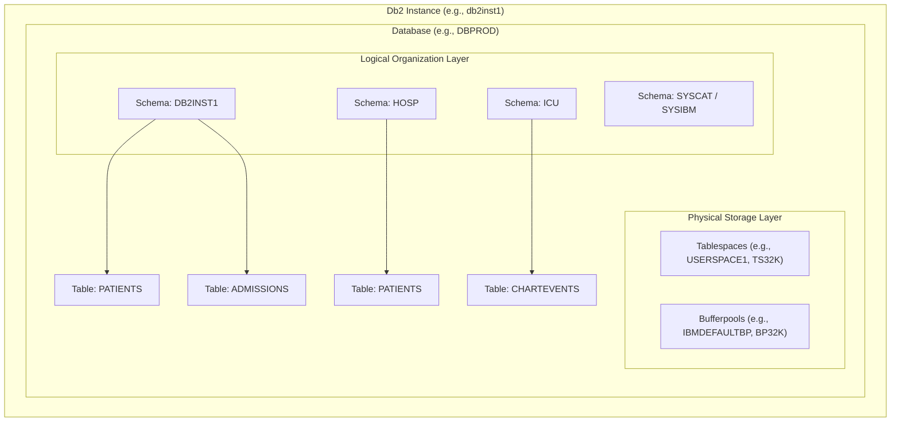

# Understanding IBM Db2 Schemas

A **schema** in IBM Db2 is a logical grouping and namespace for database objects such as tables, views, indexes, stored procedures, functions, sequences, and aliases.

Think of a schema as a **folder or namespace** inside a database: it organizes related objects, prevents naming conflicts between different applications or teams, and provides access control boundaries.

---

## 1. The Db2 Hierarchy: Where Schemas Fit

To understand schemas, it helps to see how Db2 organizes data from top to bottom:



### Key Distinctions

| Concept | What It Is | Purpose |
|---|---|---|
| **Database** | The top-level administrative container (`DBPROD`) | Manages transactions, recovery logs, and memory pools. |
| **Tablespace** | Physical storage allocation (`USERSPACE1`, `TS32K`) | Manages disk files, page sizes (4K, 8K, 16K, 32K), and bufferpools. |
| **Schema** | Logical namespace (`DB2INST1`, `SYSCAT`) | Names, groups, and secures database objects. |

> [!NOTE]
> **Schemas are independent of Tablespaces:**
> Tables in the **same schema** can live in different tablespaces (e.g. small tables in 4K, large tables in 32K). Conversely, tables from **different schemas** can share the same physical tablespace.

---

## 2. Two-Part Object Naming

In Db2, database objects always have a **two-part name**:

$$\text{<schema\_name>} . \text{<object\_name>}$$

For example:
- `DB2INST1.PATIENTS`
- `DB2INST1.ADMISSIONS`
- `SYSCAT.TABLES`

### Preventing Name Collisions
Schemas allow multiple tables to share the same name without conflict:
- `HOSP.PATIENTS` (General hospital patients)
- `RESEARCH.PATIENTS` (De-identified research cohort)
- `ICU.PATIENTS` (Intensive care unit patients)

---

## 3. Schema Resolution & `CURRENT SCHEMA`

When you write a SQL query without specifying the schema name:

```sql
SELECT * FROM PATIENTS;
```

Db2 resolves `PATIENTS` using the **`CURRENT SCHEMA`** special register.

### How Db2 Sets Default Schema
1. When you connect to Db2 as user `db2inst1`, Db2 automatically sets:
   $$\text{CURRENT SCHEMA} = \text{'DB2INST1'}$$
2. Db2 looks for `DB2INST1.PATIENTS`.
3. If found, the query succeeds. If not, Db2 returns error `SQL0204N: "<schema>.PATIENTS" is an undefined name`.

### Checking & Changing the Current Schema

You can inspect or switch your active schema at any time during a session:

```sql
-- 1. Check your active schema
VALUES CURRENT SCHEMA;

-- 2. Switch active schema to another namespace
SET CURRENT SCHEMA = 'HOSP';

-- 3. Now unqualified queries look in HOSP.*
SELECT * FROM PATIENTS;  -- Resolves to HOSP.PATIENTS
```

---

## 4. System Schemas in Db2

Db2 reserves several built-in schemas for internal metadata and catalog information:

| System Schema | Description | Example Query |
|---|---|---|
| **`SYSIBM`** | Core internal system base tables and built-in data types | Internal catalog tables (`SYSIBM.SYSTABLES`) |
| **`SYSCAT`** | Read-only catalog views for user metadata inspection | `SELECT TABNAME FROM SYSCAT.TABLES WHERE TABSCHEMA = 'DB2INST1'` |
| **`SYSSTAT`** | Optimizer catalog views with database statistics | Used by Db2's cost-based query optimizer |
| **`SYSPROC`** | Built-in administrative stored procedures | `CALL SYSPROC.ADMIN_CMD(...)` |
| **`SYSFUN`** | Built-in scalar and aggregate SQL functions | Mathematical and string built-ins |

---

## 5. Managing Schemas with SQL

### Creating a Schema
```sql
-- Explicitly create a new schema owned by a specific user
CREATE SCHEMA CLINICAL_OPS AUTHORIZATION db2inst1;
```

### Creating Tables within a Specific Schema
```sql
CREATE TABLE CLINICAL_OPS.ENCOUNTERS (
    ENCOUNTER_ID BIGINT NOT NULL PRIMARY KEY,
    PATIENT_ID   BIGINT NOT NULL,
    VISIT_DATE   DATE
) IN TS32K;
```

### Listing All Schemas in the Database
```sql
SELECT SCHEMANAME, OWNER, CREATE_TIME 
FROM SYSCAT.SCHEMATA 
ORDER BY SCHEMANAME;
```

### Granting Schema Privileges
You can control access at the schema level:
```sql
-- Allow a user to create tables inside CLINICAL_OPS
GRANT CREATEIN ON SCHEMA CLINICAL_OPS TO USER analyst1;

-- Allow a user to alter or drop tables inside CLINICAL_OPS
GRANT ALTERIN, DROPIN ON SCHEMA CLINICAL_OPS TO USER analyst1;
```

### Dropping a Schema
A schema cannot be dropped if it still contains objects (`RESTRICT` rule):
```sql
-- First drop all objects inside the schema, then drop the schema:
DROP SCHEMA CLINICAL_OPS RESTRICT;
```

---

## 6. How Schemas are Used in Our Database (`DBPROD`)

In our `DBPROD` database:
- **Default Schema:** `DB2INST1`
- **Clinical Tables & Views:** 35 total tables and views live in `DB2INST1`:
  - **Clinical Datasets:** `PATIENTS`, `ADMISSIONS`, `DIAGNOSES_ICD`, `CHARTEVENTS`, `LABEVENTS`, `ICUSTAYS`, `PRESCRIPTIONS`, etc.
  - **Dashboard Table & Alias:**
    - `DB2INST1.BIODISCOVERY_Z_PATIENTS`
    - `DB2INST1.BIODISCOVERY_Z_ALL_100_PATIENTS_SYNTHETIC_DASHBOARD` (Alias)
  - **Secure Decrypted View:**
    - `DB2INST1.V_PATIENTS_DECRYPTED` (Authorized decrypted view for `SYNTHETIC_PATIENT_NAME`)

Because you connect as user `db2inst1`, `CURRENT SCHEMA` defaults to `DB2INST1`, allowing you to query `FROM PATIENTS` directly without having to type `FROM DB2INST1.PATIENTS`.

